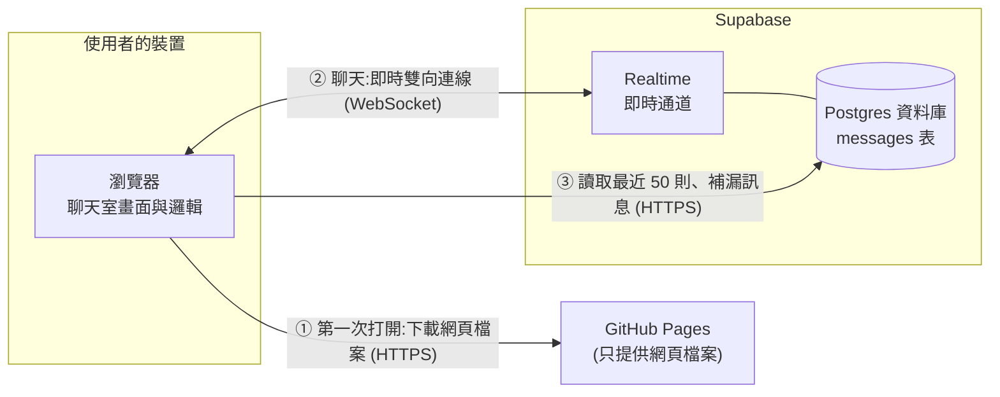
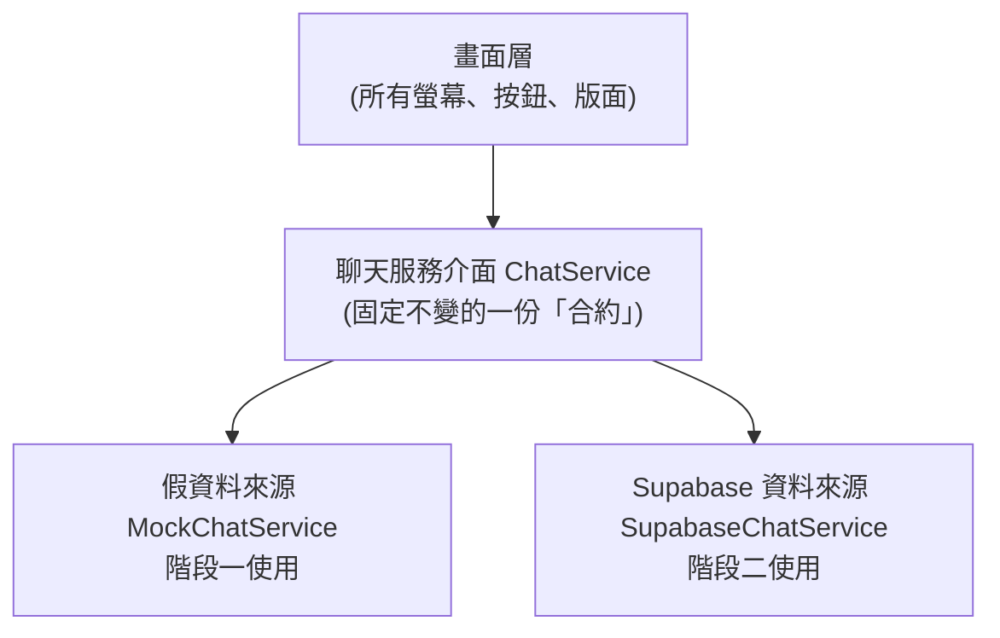
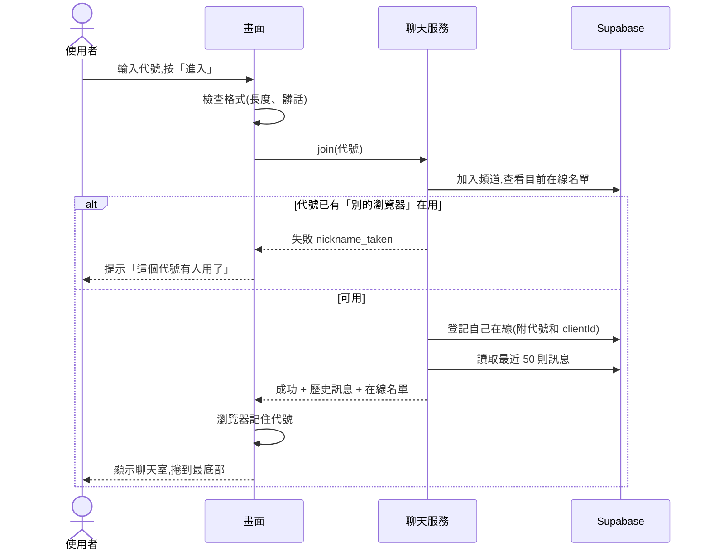
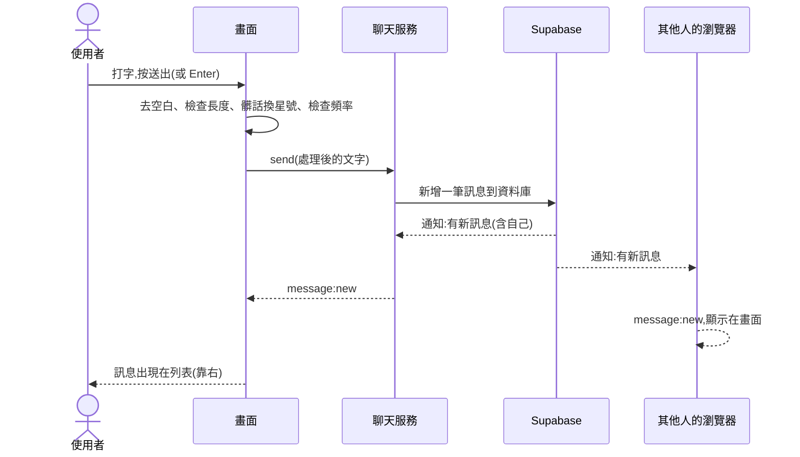
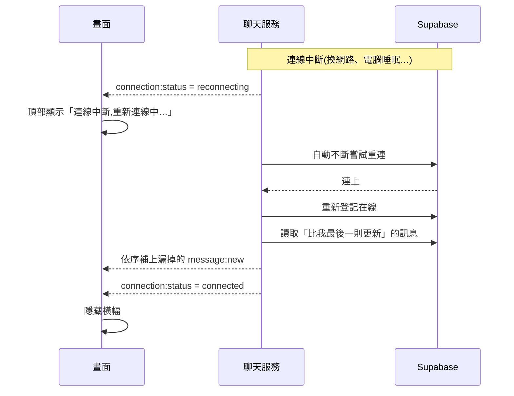

# 匿名聊天室 架構文件

> 讀者:不寫程式的專案負責人。文中第一次出現的專有名詞,會用一句話解釋。
> 狀態:階段一已完成並上線;階段二(Supabase)程式已接上,設定步驟與權限驗證結果見 `supabase/setup.md`。

---

## 1. 專案說明與目標

### 這是什麼
一個**不用登入**的匿名聊天室。任何知道網址的人,用電腦或手機打開,輸入一個代號,就能進到**同一間**聊天室和所有人聊天。

### 目標
- 打開網頁、輸入代號,三步之內就能開始聊天
- 看得到誰在線上,有人進出時有提示
- 電腦和手機都好用
- 完全免費、不用自己架伺服器

### 已經確認的使用者體驗(來自需求訪談)

| 項目 | 決定 |
|---|---|
| 進入方式 | 輸入代號,不用註冊登入 |
| 歷史訊息 | 新進來的人看得到最近 50 則 |
| 代號重複 | 擋下並提示換一個 |
| 訊息限制 | 有長度上限;髒話換成星號後照常送出 |
| 連結 | 照常送出,但顯示成純文字,不能點 |
| 離開與回來 | 瀏覽器記住代號,下次自動進入;可按「換代號」 |
| 在線名單 | 電腦固定顯示在旁邊;手機收起來,按按鈕展開 |
| 訊息樣式 | 顯示代號、時間、內容;自己的靠右、別人的靠左,顏色不同 |
| 新訊息 | 停在底部時自動捲到最新;往上翻時顯示「有新訊息」按鈕 |
| 斷線 | 上方顯示「重新連線中…」,連上後補回漏掉的訊息 |

### 做事順序
1. **階段一**:先把前端(使用者看到的畫面)做好,放到 GitHub Pages 讓大家看得到
2. **階段二**:最後才接上 Supabase,變成真正能多人即時聊天

---

## 2. 整體架構圖

先用白話講三個角色:

- **瀏覽器**:使用者手上的 Chrome、Safari 等。聊天室的畫面和邏輯都在這裡執行。
- **GitHub Pages**:GitHub 提供的免費網站空間。它只負責「把網頁檔案交給瀏覽器」,**不處理任何聊天內容**。
- **Supabase**:一個現成的後端服務(後端就是「在遠端負責存資料、轉發訊息的那一邊」)。聊天訊息的儲存和即時轉發都由它負責。



**怎麼讀這張圖:**
1. 使用者輸入網址 → 瀏覽器向 GitHub Pages 要網頁檔案 → 之後 GitHub Pages 就沒事了。
2. 網頁跑起來後,瀏覽器**直接**跟 Supabase 建立一條 **WebSocket**(一條開著不關的雙向連線,有新訊息時對方可以馬上推給你,不用你一直問「有新的嗎?」)。
3. 沒有「我們自己的伺服器」。這是刻意的,因為不用維護、也不用付費。

**階段一時**,圖中的 Supabase 整塊不存在,用瀏覽器內建的「假資料來源」代替(見第 4 節)。

---

## 3. 技術選擇

每一項都寫「選了什麼」和「為什麼」。

### 3.1 前端

| 項目 | 選了什麼 | 為什麼 |
|---|---|---|
| 程式語言 | **TypeScript** | 它是 JavaScript(網頁唯一通用的語言)加上「資料型別檢查」。可以在寫的當下就抓到「訊息資料格式寫錯」這類錯誤,對沒人逐行檢查的專案特別有用。 |
| 框架 | **React** | 框架就是「蓋網頁畫面的現成工具組」。聊天室畫面會不斷變動(新訊息、人進出、斷線提示),React 擅長「資料一變,畫面自動跟著更新」。資源和範例也最多,`/frontend-design` 產出的程式碼大多是這套。 |
| 建置工具 | **Vite** | 建置工具負責把我們寫的原始碼打包成瀏覽器看得懂的最終檔案。Vite 快、設定少,和 React、GitHub Pages 搭配是常見做法。 |

**沒選的選項:**
- 純 HTML/JS 不用框架:檔案少時最簡單,但聊天室的畫面狀態很多,寫到後面容易糾結。
- Next.js 等需要伺服器的框架:GitHub Pages 只能放靜態檔案(內容固定、不會在伺服器端運算的檔案),用不到它們的強項。

### 3.2 Supabase 使用哪些功能

Supabase 有很多功能,這個專案用到下面四個(前兩個是核心;後兩個是「新增功能」用的,見最後的〈新增功能〉一節):

| 功能 | 白話說明 | 在這個專案做什麼 |
|---|---|---|
| **Realtime** | Supabase 的即時通道,底層用 WebSocket | ① **Presence**(「在線狀態」功能):自動追蹤誰連著、誰剛進來、誰剛離開 → 做「在線名單」和「進出提示」<br/>② **Postgres Changes**(「資料庫變動通知」功能):資料庫新增一筆訊息時,自動通知所有連線中的人 → 做「即時收到新訊息」 |
| **Postgres 資料庫** | Supabase 內建的資料庫(存資料的地方,像一份很大的表格) | 存聊天訊息,用來提供「最近 50 則」和「斷線後補漏訊息」 |
| **Realtime Broadcast**(「廣播」功能) | 把一則很短的訊號即時丟給頻道裡的所有人,**不存進資料庫** | 做「○○ 正在輸入…」 |
| **資料庫觸發器**(Postgres trigger:在資料存進資料庫「之前」自動執行的一段規則) | 訊息存進去之前,由資料庫自己先檢查、必要時修改內容 | 做「伺服器端髒話過濾」和「送出頻率限制」;SQL 在 `supabase/server_rules.sql` |

**為什麼訊息要存資料庫,而不是只靠 Realtime 轉發?**
因為需求要求「新進來的人看得到最近 50 則」和「斷線重連後補回漏掉的訊息」,這兩件事都需要有地方把訊息存著。

**為什麼用 Postgres Changes,而不是 Realtime 的 Broadcast(廣播)?**
這樣「畫面上顯示的訊息」和「資料庫裡存的訊息」永遠是同一份,不會出現「大家看到了但沒存到」的狀況,也不用自己維護兩條傳送路線。以幾十到幾百人的規模,效能完全足夠。

**沒選的功能:** Supabase Auth(登入系統)——需求明確不要登入;Edge Functions(伺服器端程式)——見第 9 節的取捨說明。

---

## 4. 兩個階段,以及如何不用重寫

### 4.1 階段一:還沒接 Supabase

**前端要能做到什麼程度:** 所有畫面和互動都完整可用,只是「聊天對象」是假的:

- 完整的輸入代號流程(含代號格式檢查、「代號已被使用」提示)
- 送出訊息、顯示訊息、自己靠右/別人靠左、時間
- 髒話換星號、過長訊息的處理、連結顯示成純文字
- 在線名單、進出提示、手機/電腦版面切換
- 新訊息捲動行為、「有新訊息」按鈕
- 斷線提示(用示範橫幅右邊的「模擬斷線」測試按鈕觸發;按鈕是看得見的,方便隨時測試)
- 瀏覽器記住代號、「換代號」

**假資料來源怎麼運作(讓你在 GitHub Pages 上看得到效果):**

1. **機器人**:幾個虛構的使用者(例如「小明」「Alice」)會定時進出,並每隔幾秒說一句話。所以你一個人打開網頁,聊天室也是熱鬧的。
   **機器人是每個分頁各自執行的**:同時開兩個分頁時,兩邊的機器人說的話、進出的時間都不一樣(例如一邊的名單有「咖啡」,另一邊有「Alice」)。這是示範模式的已知現象,不是錯誤;階段二沒有機器人,就不會有這件事。
2. **多分頁互通**:利用瀏覽器的 **BroadcastChannel**(同一個瀏覽器內,不同分頁之間互相傳話的內建功能)。你在同一個瀏覽器開兩個分頁、用不同代號,就能互相聊天,用來測試「代號重複」等情境。**只有「真人」的訊息與在線狀態會在分頁間同步**,機器人不會。
3. **示範模式橫幅**:畫面最上方有一整條橫幅,固定顯示「示範模式:訊息不會傳給其他裝置」,避免有人誤以為這是真的多人聊天室。橫幅右邊有測試用的「模擬斷線」按鈕。

**限制:** 階段一**無法**跨裝置聊天(手機和電腦互傳),這要到階段二。

**怎麼看到效果:** 部署到 GitHub Pages(第 12 節),用網址打開即可。

### 4.2 階段二:接上 Supabase 之後的改變

| 項目 | 階段一 | 階段二 |
|---|---|---|
| 訊息來源 | 瀏覽器內的假資料來源 | Supabase |
| 能否跨裝置 | 否(只有同一瀏覽器的分頁) | 是 |
| 歷史訊息 | 每次重新整理即消失(或僅存在本機) | 存在 Supabase,所有人共用 |
| 示範橫幅 | 顯示 | 不顯示 |
| 畫面 | — | **完全不變** |

### 4.3 前端怎麼設計,才不用整個重寫

**核心做法:把「畫面」和「資料來源」中間隔一層固定的介面。**

白話比喻:畫面像一台電視,只認「HDMI 孔」。不管後面接的是 DVD 機(假資料)還是有線電視盒(Supabase),電視本身不用改。



規則:
1. 畫面層**只准**跟「聊天服務介面」說話,**絕對不准**直接接觸 Supabase 的任何東西。
2. 這份介面規定了有哪些動作(進入、送出、離開)和哪些事件(收到新訊息、有人進出、連線狀態改變),詳見第 5 節。
3. 假資料來源和 Supabase 資料來源**各寫一份實作**,但都遵守同一份介面。
4. 決定現在用哪一份,靠「有沒有填 Supabase 的網址與公開金鑰」:兩個值都有就用 `supabase`,缺任何一個就自動使用 `mock`。**沒有另外的「強制使用 mock」開關**;本機想看示範模式時,把 `.env.local` 暫時改名或清空即可。
5. 驗證:階段二要改的程式只有「新增 `supabaseChatService.ts`、改 `services/index.ts` 選擇用哪一份」,加上周邊設定(`package.json` 安裝 Supabase 套件、`vite-env.d.ts` 宣告兩個設定值、`deploy.yml` 把 Variables 帶進建置)。畫面層(`screens/`、`components/`、`hooks/`、`App.tsx`)的檔案**不應該出現在修改清單中**。若出現,代表當初的分隔沒做好。(階段二實際做完,畫面層確實一個檔案都沒改。)(後來加的「新增功能」有動到畫面層,那是另外的功能,與「切換到 Supabase」無關。)

---

## 5. 通訊約定:事件名稱與資料格式

這一節是「合約」。兩份資料來源、畫面層都照這份來。

### 5.1 資料格式

**使用者(User)**

| 欄位 | 意義 | 範例 |
|---|---|---|
| `nickname` | 代號 | `小明` |
| `clientId` | 這個**分頁**的隨機識別碼(第一次打開時自動產生,存在瀏覽器的 sessionStorage;重新整理不變,關掉分頁就換新的) | `a3f9…`(一串隨機字元) |
| `joinedAt` | 進入時間 | 時間戳記 |

> `clientId` 的用途:① 判斷哪些訊息是「我自己」發的(不能只靠代號,因為代號被人離開後別人可以重用);② 重新整理頁面時,證明「我就是剛才那個人」,避免被自己舊的連線擋在門外(見 6.1)。它不是密碼,不具保密功能。
>
> 為什麼是「每個分頁一個」而不是「每個瀏覽器一個」:同一個瀏覽器開兩個分頁、用不同代號時,如果共用同一個識別碼,會被當成同一個人(在線名單只出現一個、自己的訊息跑到另一個分頁的右邊)。代價是:關掉分頁後再開新分頁,會是新的識別碼。伺服器通常在關閉分頁後數秒內就把舊連線視為離線,所以重開時一般不會被自己擋住。

**訊息(Message)**

| 欄位 | 意義 | 範例 |
|---|---|---|
| `id` | 訊息唯一編號(用來避免重複顯示) | 資料庫自動產生 |
| `nickname` | 發送者代號 | `小明` |
| `clientId` | 發送者的瀏覽器識別碼 | `a3f9…` |
| `text` | 訊息內容(已過濾,最多 200 字) | `大家好 ***` |
| `sentAt` | 送出時間,**由資料庫在收到時蓋章**,不信任使用者裝置的時鐘 | `2026-10-13 14:05:09 (UTC)` |

**系統提示(SystemNotice)**:有人進出的提示行。**不存入資料庫**,所以不會出現在歷史訊息裡。

**連線狀態**:`connecting`(連線中)/ `connected`(已連線)/ `reconnecting`(重新連線中)。

### 5.2 事件名稱

| 事件名稱 | 誰發出 | 帶什麼資料 | 畫面收到後做什麼 |
|---|---|---|---|
| `message:new` | 資料來源 | 一則 Message | 加到訊息列表,依捲動位置決定自動捲動或顯示「有新訊息」 |
| `presence:sync` | 資料來源 | 目前所有在線 User 的清單 | 更新在線名單與人數 |
| `user:joined` | 資料來源 | 一個 User | 顯示「○○ 進來了」 |
| `user:left` | 資料來源 | 一個 User | 顯示「○○ 離開了」 |
| `connection:status` | 資料來源 | 連線狀態 | 顯示或隱藏頂部的重新連線橫幅 |
| `messages:gap` | 資料來源 | (無) | 斷線太久、補不回全部訊息時,在訊息串插入「中間有部分訊息未顯示」 |
| `typing:update` | 資料來源 | 目前「別人」正在輸入的 User 清單(不含自己;有人開始或停止輸入就重發一次完整清單) | 在輸入框上方顯示「○○ 正在輸入…」(新增功能) |

### 5.3 動作(畫面層呼叫資料來源)

| 動作 | 輸入 | 回傳 |
|---|---|---|
| `join` | 代號 | 成功(**同時回傳最近 50 則訊息與目前在線名單**,所以不需要另外的「讀取歷史訊息」動作),或失敗(原因:`nickname_taken` 已被使用 / `invalid` 格式不合 / `network` 連不上) |
| `send` | 文字 | 成功或失敗(失敗原因:`too_long` 太長、`empty` 空白、`rate_limited` 被資料庫的頻率限制擋下、`network` 網路問題) |
| `notifyTyping` | — | (沒有回傳)告訴其他人「我正在輸入」。畫面在使用者打字時呼叫,資料來源自己負責節流(最多每 1.5 秒一次)(新增功能) |
| `leave` | — | — |

### 5.4 輸入規則(前端強制執行)

| 項目 | 規則 |
|---|---|
| 代號 | 去掉前後空白後 1–24 個字;不可含髒話;不可全是空白。連續空白會合併成一個、不可見字元會被移除。**判斷「代號有沒有人用」時不分大小寫**(`Alice` 和 `alice` 視為同一個) |
| 訊息 | 去掉前後空白後 1–200 字;可換行但**最多 10 行**(連續 3 個以上的換行會壓成 2 個)。超過字數或行數時送出按鈕停用;字數接近上限(約 180 字起)才顯示計數,超過行數時提示「最多 10 行」 |
| 髒話 | 命中的字詞整段換成同長度的 `*`,仍然送出。**資料庫端也會再過濾一次**(見 9.2),所以就算有人繞過網頁,存進去的也是過濾後的內容 |
| 連結 | 不特別處理內容,只保證**永遠當純文字顯示** |
| 送出頻率 | 前端:同一個畫面每秒最多送 1 則,太快時提示「請稍等」。**資料庫端另有保護**:同一個識別碼 5 秒內最多 8 則,超過的會被拒絕(見 9.2) |

---

## 6. 資料流:每一種情況發生什麼事

### 6.1 進入聊天室



**重點細節:**
- **記住代號**:代號存在瀏覽器的 **localStorage**(瀏覽器內建的小型儲存空間,關掉網頁也不會消失)。下次打開時,直接嘗試用這個代號進入,不顯示輸入畫面;按「換代號」才清掉並回到輸入畫面。
- **重新整理不會被自己擋住**:重新整理時,舊的連線在伺服器端可能還要幾秒才被判定離線。判斷「代號被占用」時,如果占用者的 `clientId` 和自己相同,視為同一個人,允許進入。
- **記住的代號被別人搶先用了**:自動進入失敗時,回到輸入畫面並提示「你上次的代號 ○○ 現在有人在用,請換一個」。
- **同時搶同一個代號的極小機率衝突**:見第 9 節「已知限制」。
- **連不上時自動重試一次**:Supabase 的即時連線閒置一陣子後,第一次連線偶爾會失敗。進入聊天室時如果第一次連不上(`network`),會等約 1 秒自動再試一次;代號被占用、格式不合這類明確的答案不會重試。失敗原因會記錄在瀏覽器的 console,方便診斷。

### 6.2 送出訊息



**重點細節:**
- **自己的訊息也是等伺服器通知後才顯示**,不是按下送出就直接顯示。好處是「你看到的一定就是存起來的」;壞處是網路慢時會有一小段延遲。送出後輸入框先清空,訊息旁顯示「傳送中」,收到通知後消失。
- 送出失敗(網路問題):按下送出時輸入框就會清空;失敗的訊息留在列表中並標示「傳送失敗」,點「重送」會用同樣的內容再送一次,內容不會遺失。
- 用 `id` 去重:同一則訊息不會因為重連而顯示兩次。
- **資料庫會在存入前再檢查一次**:代號含髒話、5 秒內超過 8 則,都會被拒絕(畫面上那則訊息顯示「傳送失敗」,可以稍後按「重送」);訊息內容裡的髒話會被換成 `*`。因為畫面顯示的是資料庫存的那一份,所以看到的就是過濾後的版本。

### 6.3 離開

- **關掉分頁/關瀏覽器**:頁面關閉前會**主動**通知大家「我離開了」(取消在線登記並廣播,盡力而為,不一定送得出去);同時瀏覽器中斷連線,Supabase 也會偵測到並通知其他人。其他人收到後顯示「○○ 離開了」並從名單移除。通常數秒內完成(尤其手機直接把瀏覽器滑掉時可能稍慢)。
- **萬一離開通知沒送到(心跳機制)**:伺服器的離開通知可能被延遲或漏掉(伺服器忙、網路被直接切斷、瀏覽器被強制結束)。為了不讓名單永遠卡著已經離開的人,每個人**每 5 秒更新一次自己的「心跳」**(一個一直變動的數字);其他人用**自己的時鐘**記錄「最後一次看到這個人的心跳有變」是什麼時候,**超過 25 秒沒變就視為已離開**,同樣顯示「○○ 離開了」並更新名單。這樣不需要比較不同裝置的時鐘,裝置時間不準也沒關係。每 2 秒核對一次,所以這種情況下最久約 27 秒內名單一定會更新。計時用 Web Worker(獨立的背景執行緒),在背景分頁也不會被瀏覽器放慢。
- 心跳造成的更新不會讓「進來了/離開了」提示重複出現:畫面會先比對「目前認為在線的人」和「實際還活著的人」,只對**真正的差異**產生提示。另外,**伺服器說某人離開後,會再等 8 秒才宣布**(Supabase 的連線有時會被短暫重連,對方會消失幾秒又回來,這個緩衝避免畫面一直跳「離開了/進來了」);所以一般的「關掉分頁」約 9 秒內名單更新。舊版(沒有心跳)的使用者一律當作在線。限制:手機瀏覽器在背景時可能暫停程式,心跳會停,別人會暫時把你當成離開,回到前景後自動回來。
- **連線被伺服器關掉時自己重新連線**:實測發現,Supabase 的即時連線有時會被伺服器「乾淨地」關閉(尤其伺服器忙碌或擴充容量時,約每 30 秒一次),而且 Supabase 的程式庫**不一定會自己重連**,結果頁面卡在「重新連線中」、再也收不到任何更新,名單就永遠不會變。所以資料來源自己負責:偵測到頻道關閉或出錯,就用 1 秒起、最多 10 秒的間隔(每次失敗加倍)重新建立連線並重新加入,成功後補回斷線期間漏掉的訊息、補發進出提示、更新名單。使用者在重連途中按「換代號」,會立刻停止重連。
- **按「換代號」**:**立刻離開,不再跳確認視窗**(原本有確認視窗,但離開並不危險,想回來再輸入一次代號就行;多一道確認反而讓使用者和自動化測試都容易卡在那一步)。離開時會先**主動廣播「我離開了」**,其他人收到就立刻把對方移出名單並顯示「○○ 離開了」(不用等伺服器通知和 8 秒緩衝),然後清掉記住的代號、回到輸入畫面,畫面上顯示一行「你已離開聊天室」。

### 6.4 斷線重連



**重點細節:**
- 斷線期間輸入框仍可打字,但送出按鈕停用並提示「連線後才能送出」。
- 補訊息時用 `id` 去重,避免重複。
- 若斷線太久,漏掉的訊息超過 50 則:只補最新 50 則,並在中間顯示一行「中間有部分訊息未顯示」。
- 重連後在線名單以 `presence:sync` 整份重建,不依賴斷線期間的零散事件。
- 重連有兩條路:① Supabase 自己重連成功(重新登記在線、補訊息);② Supabase 沒有自己重連時,資料來源每 2 秒檢查一次頻道狀態,連續兩次都是「已關閉/出錯」就自己重新建立連線(見 6.3)。

### 6.5 正在輸入(新增功能)

- 使用者在輸入框打字(有內容時),畫面呼叫 `notifyTyping`。資料來源用 Realtime 的**廣播**把「我是誰、我正在輸入」丟給頻道裡的其他人(最多每 1.5 秒一次),**不存進資料庫**。
- 其他人收到後,資料來源記下「誰正在輸入」,發出 `typing:update`;畫面顯示「○○ 正在輸入…」(兩人時顯示兩個名字,三人以上顯示「N 個人正在輸入」)。
- 約 3.5 秒沒有再收到訊號、對方送出訊息、對方離開、或自己斷線,就會從清單移除。自己的畫面不會顯示自己。
- 示範模式:同一個瀏覽器的其他分頁會互相看到;機器人在「說話前」也會先顯示一下「正在輸入…」,讓你一個人也看得到這個功能。

---

## 7. 畫面清單

只描述「有什麼元素、做什麼事」。顏色、字體、間距、動畫由 `/design` 負責。

### 畫面 A:輸入代號

| 元素 | 行為 |
|---|---|
| 標題與一句說明 | 說明這是不用登入的匿名聊天室 |
| 代號輸入框 | 即時顯示字數(上限 24);按 Enter 等同按「進入」 |
| 「進入聊天室」按鈕 | 格式不合時停用 |
| 錯誤提示區 | 顯示:格式不合、「這個代號有人用了」、「上次的代號現在有人在用」、連不上 |
| 「示範模式」橫幅(僅階段一) | 說明訊息不會傳給其他裝置 |

### 畫面 B:聊天室

| 元素 | 行為 |
|---|---|
| **頂部列** | 顯示聊天室名稱、目前在線人數、自己的代號、「換代號」按鈕 |
| **連線橫幅** | 只在 `reconnecting` 時出現:「連線中斷,重新連線中…」 |
| **訊息列表** | 由舊到新排列;每則顯示代號、時間(使用者本地時間,時:分)、內容。自己的靠右、別人的靠左。內容保留換行、永遠是純文字(連結不可點)。<br/>進出提示以置中的小字穿插在列表中。 |
| **「有新訊息」按鈕** | 只在「使用者往上翻、此時又有新訊息」時出現於列表底部;點擊後捲到最新並消失;使用者自己捲回底部時也消失 |
| **自動捲動規則** | 在底部(允許些微誤差)→ 新訊息來就自動捲到底。不在底部 → 不動,改顯示按鈕。**自己送出的訊息**一律捲到底。 |
| **在線名單** | 列出所有在線代號,自己標示「(你)」。<br/>電腦:固定在聊天區旁邊。<br/>手機:預設收起,點頂部列的「在線 N 人」按鈕從側邊或底部展開,再點一次或點外面關閉。 |
| **輸入區** | 多行輸入框 + 送出按鈕 + 字數計數(接近上限時才顯示)。<br/>**所有裝置:Enter 送出、Shift+Enter 換行**(手機的鍵盤會顯示「送出」鍵;手機沒有 Shift 鍵,所以手機上無法換行)。電腦版輸入框下方顯示操作提示,觸控裝置不顯示。輸入法組字中的 Enter(選字)不會送出。<br/>空白或超過 200 字時送出按鈕停用。 |
| **訊息狀態** | 自己的訊息在「傳送中」「傳送失敗(可重送)」時有對應標示 |
| **「正在輸入」提示**(新增功能) | 輸入框上方永遠保留一行高度(避免畫面跳動)。別人正在輸入時顯示「○○ 正在輸入…」,沒有人輸入時是空白 |
| **分頁標題未讀數**(新增功能) | 這個分頁在背景時,別人的新訊息會累計成未讀數,瀏覽器分頁標題變成「(3) 匿名聊天室」;回到分頁就歸零。自己送的訊息不計,只影響自己的畫面 |

### 換代號(沒有確認視窗)

頂部列的「換代號」按鈕按下去**立刻離開**聊天室、回到畫面 A,並在代號輸入框下方顯示一行說明「你已離開聊天室。想再進來,輸入一個代號就可以。」(開始輸入就消失)。不再有確認視窗。

### 響應式版面規則
- 手機(窄螢幕):單欄,在線名單收起。
- 電腦(寬螢幕):訊息區加右側固定的在線名單。
- 手機虛擬鍵盤跳出時,輸入框必須保持可見,不被鍵盤蓋住。

---

## 8. 金鑰

**金鑰**就是「用來證明身分、取得某項服務使用權的一串長字元」。這個專案只會碰到下面這些。

### 8.1 會用到的東西

| 名稱 | 是什麼 | 能公開嗎 | 放哪裡 |
|---|---|---|---|
| **Project URL** | 你的 Supabase 專案的網址 | ✅ 可以 | 前端設定 |
| **anon key**(新版介面可能叫 **publishable key**) | 「匿名使用者的通行證」。任何打開網頁的人都會用它連到 Supabase。它**本來就設計成放在前端、會被所有人看到**。 | ✅ 可以公開 | 前端設定 |
| **service_role key**(新版可能叫 **secret key**) | 「萬能管理員鑰匙」,可以繞過所有權限規則,讀寫、刪除整個資料庫。 | ❌ **絕對不能公開** | **這個專案完全用不到,不要複製、不要存放任何地方** |
| **資料庫密碼** | 建立 Supabase 專案時設定的密碼 | ❌ **絕對不能公開** | 自己用密碼管理工具保管;專案程式用不到 |
| **Supabase 帳號密碼 / GitHub 帳號密碼** | 你自己的登入資料 | ❌ | 不要寫進任何檔案 |

### 8.2 為什麼 anon key 公開也安全?
因為真正擋住壞人的不是「藏起這把鑰匙」,而是 Supabase 資料表上的 **RLS(Row Level Security,資料列安全規則)**——一組寫在資料庫裡的規則,規定「匿名使用者只能做哪些事」。階段二會設定成:

- 可以:讀取訊息、新增訊息
- 不可以:修改訊息、刪除訊息
- 新增時資料庫會檢查:代號 1–24 字、內容 1–200 字,不合就拒絕
- 匿名者只能填代號、識別碼、內容這三個欄位,**不能自己指定訊息編號和時間**(欄位層級權限);時間一律由資料庫蓋章
- 另外,資料庫的**觸發器**會在每則訊息存入前:拒絕含髒話的代號、拒絕「同一識別碼 5 秒內超過 8 則」、把內容裡的髒話換成 `*`(見 `supabase/server_rules.sql`)

所以就算有人拿到 anon key,也只能做到「用這個聊天室本來就允許的動作」。**RLS 是這個專案真正的安全底線,階段二一定要確認有開啟。**

### 8.3 怎麼產生
1. 登入 Supabase 網站 → 建立新專案(Project)
2. 進入專案 → 左側設定(Project Settings)→ API 頁面
3. 複製 **Project URL** 和 **anon / publishable key** 這兩個值
4. 頁面上同時會看到 service_role / secret key——**不要複製它**

### 8.4 放在哪裡

| 場合 | 位置 | 說明 |
|---|---|---|
| 自己電腦開發 | 專案根目錄的 `.env.local` 檔 | **環境變數**檔(把設定值放在程式碼之外的檔案)。此檔被列入忽略清單,不會進 Git。 |
| 範本 | 專案根目錄的 `.env.example` 檔 | 只列出變數名稱,值留空,**會**進 Git,讓別人知道要填什麼 |
| 正式網站 | GitHub 專案設定 → Secrets and variables → Actions → **Variables** | 部署時由 GitHub 自動把值帶進去。因為這兩個值本來就會被打包進公開網頁,所以放 Variables 即可,不需要 Secrets。 |

> 提醒:網頁一旦部署,anon key 一定看得到(打開瀏覽器開發人員工具就能看)。這是正常的,不是外洩。

### 8.5 怎麼避免不該公開的東西被 commit 到 GitHub
**commit** = 把修改存成 Git 的一筆紀錄;推上 GitHub 後,紀錄會永遠留在歷史裡,即使之後刪掉檔案也找得回來。所以重點是「事前防範」:

1. `.gitignore`(Git 的忽略清單)一開始就列入:`.env`、`.env.local`、`.env.*.local`。
2. 專案裡**只有** `.env.example` 可以進 Git,而且裡面只能是空值。
3. service_role / secret key 從頭到尾不進電腦的任何專案檔案,等於根本沒有東西可以洩漏。
4. 每次 commit 前執行 `git status`,確認清單裡沒有 `.env` 開頭的檔案。
5. 開啟 GitHub 的 **Secret scanning / Push protection**(GitHub 內建的自動掃描,偵測到常見金鑰格式時會阻止推送)。位置:Repo → Settings → Code security。
6. **萬一外洩了**:到 Supabase 的 API 設定頁重新產生(rotate)該金鑰,舊的立刻失效。只有 anon key 外洩不需要驚慌(見 8.2)。

---

## 9. 安全與限制

### 9.1 別人可能送什麼奇怪的東西進來?前端怎麼擋?

| 情況 | 風險 | 處理方式 |
|---|---|---|
| 訊息中夾帶網頁程式碼,例如 `<script>…` 或 `` | **XSS**(跨站腳本攻擊:讓別人的瀏覽器執行不該執行的程式) | React 預設會把所有文字當純文字顯示,不會當成網頁碼執行。**規定:整個專案禁止使用任何會把文字當 HTML 插入的寫法**(程式碼審查時要檢查) |
| 網址連結(含釣魚、惡意網站) | 使用者誤點 | 依需求:顯示成純文字,**不做成可點擊的連結** |
| 超長訊息、大量換行 | 洗版、拖慢畫面 | 限制 200 字、最多 10 行,超過時送出按鈕停用並提示;連續空行壓縮成一行。(沒有「只顯示前幾行再展開」的功能。) |
| 瘋狂連續送出 | 洗版 | 前端限制每秒 1 則;**資料庫也限制**同一識別碼 5 秒內最多 8 則 |
| 冒充他人代號 | 混淆 | 同一時間代號唯一;離線後別人可使用(匿名聊天室固有特性) |
| 代號或訊息含髒話 | 不當內容 | 前端:髒話換星號、代號含髒話不給進入。**資料庫端也會做**:訊息內容換星號、含髒話的代號無法發言 |
| 用奇怪的字元(隱形字、超長組合符號、RTL 反向文字) | 畫面錯亂、假裝成別的代號 | 代號限制為一般文字、去掉不可見與控制字元;訊息顯示區限制內容不超出框 |
| 純空白的代號或訊息 | 看起來像空的 | 去掉前後空白後必須至少 1 字 |
| 別人推來的資料格式不對(Realtime 推來的訊息、在線資料、輸入訊號) | 資料損壞或有人偽造,導致畫面錯亂或當機 | **收到的資料先檢查再處理**:訊息的代號必須是 1–24 字的文字、內容 1–200 字、識別碼 1–64 字、編號與時間必須存在且格式正確;在線資料與輸入訊號也檢查代號與識別碼。**不合格的整筆丟掉**,不顯示、不處理(`supabaseChatService.ts` 的 `parseRow`、`parseMeta`) |

### 9.2 誠實的限制:前端擋不住「刻意繞過」的人
前端的所有檢查(髒話、頻率、字數)只是**方便正常使用者**的防線。有技術的人可以不經過你的網頁,直接用公開的 anon key 對 Supabase 送資料,繞過這些檢查。階段二的對策與取捨:

| 項目 | 能否在伺服器端強制 | 這一版的做法 |
|---|---|---|
| 字數上限 | ✅ 可以(資料庫規則) | 在資料庫加規則,不合就拒絕 |
| 只能新增、不能改/刪 | ✅ 可以(RLS) | 設定 RLS |
| 訊息編號與時間不能由使用者指定 | ✅ 可以(欄位層級權限) | 匿名者只能寫代號、識別碼、內容三個欄位 |
| 髒話過濾 | ✅ 可以(資料庫觸發器) | **前端與資料庫都做**:存入資料庫前再過濾一次(`supabase/server_rules.sql`)。限制:只涵蓋清單裡的字詞 |
| 送出頻率限制 | ✅ 可以(資料庫觸發器) | **前端與資料庫都做**:同一識別碼 5 秒內最多 8 則。限制見下一段 |
| 代號唯一 | ⚠️ 不完全可靠 | 見下一段 |

**伺服器端規則的限制:** 送出頻率是依「識別碼」計算,而識別碼是使用者自己填的,所以有技術的人**換一個識別碼就能繞過頻率限制**(匿名、不登入的聊天室,沒辦法可靠地認出「同一個人」)。它擋得住一般的洗版,擋不住刻意偽造識別碼的人。另外它不是精確的硬上限:實測 30 個請求同時送出時,最多放行了 10 則(上限 8),因為「查最近幾則」和「新增」之間有極短的空隙(做法見 `supabase/setup.md`)。髒話過濾是針對內容,不受識別碼影響,但只涵蓋清單裡的字詞;用空格、諧音、拆字就能繞過。

**識別碼(`clientId`)可被冒用的已知限制:** 識別碼存在資料表裡,而且所有人都讀得到(讀取訊息本來就是允許的),畫面又用它判斷「這則是不是我發的」。所以理論上,有技術的人可以用**別人的識別碼**送訊息,這則訊息在被冒用者的畫面上會顯示成「自己」(靠右、冰藍色);也可以用別人的識別碼登記在線。後果是混淆,不會洩漏資料或改動別人的訊息。這一版接受;若日後在意,需要改成由伺服器簽發的身分,但那會需要登入或伺服器端程式,超出這一版範圍。

**代號唯一性的已知限制:** 判斷方式是「進入前看目前在線名單」。如果兩個人在**同一瞬間**搶同一個代號,理論上可能都通過。機率極低,且後果只是兩人暫時同名,所以這一版接受。若日後在意,可改用資料庫的「唯一限制」機制,但需要處理「斷線後如何釋放代號」的複雜問題。

### 9.3 免費方案的上限(請留意)
> 以下數字是撰寫時的大致情況,各家政策會調整,**部署前請以官方定價頁為準**。

**Supabase 免費方案:**
- 同時連線人數有上限(約數百人等級)——聊天室同時在線人數超過上限,新的人會連不上
- 每秒訊息數有上限——一般聊天不會碰到
- 資料庫容量約 500 MB——純文字訊息很小,短期內不會滿,但長期不清理總會累積
- **閒置會暫停**:免費專案若連續約一週沒有活動,會被自動暫停,需要到後台手動恢復。如果聊天室很久沒人用,再打開時可能連不上
- 免費帳號可建立的專案數有上限

**GitHub Pages 免費:**
- 網站大小與每月流量有上限(這個專案體積很小,不會碰到)
- 免費帳號的網站通常要求 repo 為**公開**——所以程式碼、`.env.example`、歷史紀錄任何人都看得到,這也是第 8 節要這麼小心的原因

---

## 10. 這一版刻意不做的事

| 不做 | 為什麼 |
|---|---|
| 註冊/登入 | 需求明確不要 |
| 多個聊天室、私訊 | 需求是「所有人在同一間」;多房間會讓架構複雜很多 |
| 圖片、檔案、貼圖上傳 | 需要檔案儲存和內容審查,超出範圍 |
| 修改/刪除已送出的訊息 | 匿名下無法確認「這是你的訊息」,且 RLS 設定為只可新增 |
| 管理員、踢人、檢舉 | 沒有帳號體系就沒有可靠的「誰」可以管理 |
| 往上捲動載入更早的歷史 | 需求只要求最近 50 則 |
| 自動清除舊訊息 | 免費容量短期夠用;日後可用排程功能補上 |
| 已讀回條 | 增加大量即時事件,與核心需求無關 |
| 推播通知(桌面通知、聲音) | 非必要 |
| 多語系介面 | 先只提供繁體中文 |
| 可點擊的連結 | 需求決定顯示成純文字(也更安全) |
| 自己的伺服器 | 刻意使用 GitHub Pages + Supabase 的免維護組合 |

---

## 11. Repo 的資料夾結構

**Repo** = 存放整個專案檔案與修改歷史的地方(在 GitHub 上)。以下是目前的結構:

```
anonymous-chat/
├── docs/
│   ├── requirements.md        需求說明
│   ├── architecture.md        本文件
│   ├── design.md              視覺設計規格(顏色、字體、各畫面的長相)
│   └── design/
│       └── chat-design.html   可預覽的設計稿(用瀏覽器直接打開)
├── .github/
│   └── workflows/
│       └── deploy.yml         自動部署到 GitHub Pages 的設定
├── public/                    原樣複製到網站的靜態檔(網站圖示等)
├── src/
│   ├── main.tsx               程式進入點
│   ├── App.tsx                決定現在顯示哪個畫面
│   ├── screens/               ← 畫面層
│   │   ├── JoinScreen.tsx         畫面 A:輸入代號
│   │   └── ChatScreen.tsx         畫面 B:聊天室
│   ├── components/            ← 畫面零件
│   │   ├── MessageList.tsx
│   │   ├── MessageItem.tsx
│   │   ├── OnlineList.tsx
│   │   ├── TypingIndicator.tsx        「○○ 正在輸入…」提示(新增功能)
│   │   ├── MessageInput.tsx
│   │   ├── ConnectionBanner.tsx
│   │   └── DemoBanner.tsx         示範模式橫幅(含測試用的「模擬斷線」按鈕)
│   │   (「有新訊息」按鈕直接寫在 MessageList.tsx 裡,因為它和捲動位置綁在一起)
│   ├── hooks/
│   │   ├── useChat.ts             聊天室的狀態:訊息、在線名單、連線狀態、傳送中的訊息、誰正在輸入
│   │   └── useUnreadTitle.ts      分頁標題未讀數(新增功能)
│   ├── services/              ← 資料來源層(畫面層禁止跳過這裡)
│   │   ├── types.ts               第 5 節的資料格式與 ChatService 介面
│   │   ├── index.ts               依設定選擇用 mock 或 supabase(有 Supabase 網址和金鑰才用 supabase)
│   │   ├── mockChatService.ts     階段一:假資料來源
│   │   ├── mockBots.ts            階段一:機器人的名單與台詞
│   │   ├── typingTracker.ts       記錄「誰正在輸入」,兩個資料來源共用(新增功能)
│   │   ├── presenceLiveness.ts    用「心跳」判斷誰還在線上(伺服器沒通知離開時的保險)
│   │   └── supabaseChatService.ts 階段二:Supabase 資料來源
│   ├── lib/                   ← 與畫面、後端無關的小工具
│   │   ├── validate.ts            代號與訊息檢查
│   │   ├── profanity.ts           髒話過濾邏輯
│   │   ├── badWords.ts            髒話清單(獨立成檔,方便維護)
│   │   ├── clientId.ts            產生與讀取 clientId(每個分頁一個)
│   │   ├── nickColor.ts           代號顏色的分配、時間格式
│   │   └── storage.ts             記住代號(localStorage)
│   ├── styles/                ← 外觀(由 /design、/frontend-design 產出)
│   └── vite-env.d.ts          宣告 Supabase 網址與金鑰這兩個設定值的型別
├── supabase/
│   ├── setup.md               階段二:在 Supabase 後台要做的設定步驟、資料表規格、權限驗證結果
│   └── server_rules.sql       伺服器端規則(代號長度、送出頻率限制、髒話過濾),在 SQL Editor 執行
├── .env.example               環境變數範本(只有名稱,沒有值)
├── .gitignore                 忽略清單(含 .env.local)
├── index.html
├── package.json               專案使用的工具清單
├── package-lock.json          鎖定套件版本(自動產生,不要手動改)
├── tsconfig.json              TypeScript 設定
├── vite.config.ts             Vite 設定(含網站子路徑)
├── CLAUDE.md                  給 Claude Code 的專案規則(目前階段、不可 commit 金鑰等)
└── README.md                  專案簡介與如何在自己電腦跑起來
```

**這個結構呼應第 4.3 節的規則:** `screens/` 與 `components/` 不能直接引用 `supabaseChatService.ts`,只能透過 `services/index.ts`。

---

## 12. 部署到 GitHub Pages

### 為什麼不能直接把原始碼丟上去
我們寫的是 TypeScript + React,瀏覽器看不懂,必須先**建置(build)**——把原始碼轉成瀏覽器能執行的 HTML/CSS/JS。所以部署做法是讓 GitHub **自動建置再發布**。

### 一次性設定
1. Repo 設為**公開**(免費帳號使用 Pages 的條件)
2. Repo → Settings → Pages → Source 選 **GitHub Actions**
3. (階段二才需要)Repo → Settings → Secrets and variables → Actions → **Variables**,新增 `VITE_SUPABASE_URL` 與 `VITE_SUPABASE_ANON_KEY`
4. 設定 Vite 的網站基礎路徑為 `/anonymous-chat/`。GitHub Pages 的網址形如 `https://<帳號>.github.io/anonymous-chat/`,網頁位在子路徑下,不設的話會找不到檔案、畫面一片空白(這是最常見的踩雷)

### 每次更新的流程


### 階段一與階段二的差別
- 階段一:不設定任何 Supabase 變數 → 建置出的網站自動進入示範模式(mock)
- 階段二:加入兩個 Variables → 重新部署 → 自動切換為 Supabase,不需改畫面程式
- 這兩個 Variables 要靠 `deploy.yml` 的建置步驟(`env:` 區塊)才會被帶進網頁,所以 `deploy.yml` 在階段二多了這一段。沒設定 Variables 時,值是空字串,網頁自動退回示範模式。

### 注意事項
- 部署完成後用**無痕視窗**打開,避免看到舊版快取
- 變數名稱要以 `VITE_` 開頭,Vite 才會把它帶進網頁(也提醒你:帶進網頁 = 公開,所以只能放 anon key,不能放任何機密)

---

## 13. 驗證清單

### 階段一(假資料來源)

**進入流程**
- [ ] 輸入有效代號可進入聊天室
- [ ] 空白、超過 24 字、含髒話的代號被擋下並顯示對應提示;24 字以內的長代號可以進入,版面不跑掉
- [ ] 同一瀏覽器開兩個分頁,第二個用相同代號 → 被擋下並提示「這個代號有人用了」
- [ ] 重新整理頁面 → 自動用同一個代號進入,不被「自己」擋住
- [x] 按「換代號」→ 立刻離開、回到輸入畫面並顯示「你已離開聊天室」;其他人立刻(不到 2 秒)看到「○○ 離開了」並更新名單;下次打開不再自動進入(線上版實測:0.5 秒)
- [x] **評分式流程重演**(用無頭瀏覽器 Playwright,A、B 各開一個獨立的瀏覽器,進入、互傳訊息、再讓 B 離開,量 A 的名單多久更新;線上版,2026-10-13):按「換代號」0.5 秒、關掉分頁 11 秒、關掉整個瀏覽器 12 秒、導向空白頁 12 秒、模擬斷網(連線還開著)25 秒

**訊息**
- [ ] 打開後看到歷史訊息(示範模式是 10 則由機器人預先產生的對話;Supabase 模式是最近 50 則)
- [ ] 送出訊息 → 出現在右側、顯示代號和時間
- [ ] 機器人訊息出現在左側、顏色不同
- [ ] 兩個分頁互相傳訊息可收到
- [ ] 超過 200 字無法送出;超過 10 行無法送出並提示「最多 10 行」;空白無法送出
- [ ] 髒話被換成星號後仍送出
- [ ] 貼入網址 → 顯示成純文字、點了沒反應
- [ ] 貼入 `<script>alert(1)</script>` 與 `` → 原樣顯示為文字、沒有跳出任何東西
- [ ] 連續快速送出 → 出現「請稍等」限制
- [ ] 訊息含換行時顯示正確;Enter 送出、Shift+Enter 換行(電腦與手機一樣);用注音等輸入法選字時按 Enter 不會誤送出

**在線與提示**
- [ ] 在線名單與人數正確,自己標示「(你)」
- [ ] 機器人進出時出現「○○ 進來了/離開了」提示
- [ ] 手機寬度:名單預設收起,點按鈕可展開、可關閉
- [ ] 電腦寬度:名單固定顯示在旁邊

**捲動**
- [ ] 停在底部時,新訊息自動捲到最新
- [ ] 往上翻時來新訊息 → 畫面不動、出現「有新訊息」按鈕;點擊後跳到最新並消失
- [ ] 自己送出訊息時一律捲到底

**斷線(用模擬斷線按鈕)**
- [ ] 觸發後顯示「重新連線中…」橫幅、送出按鈕停用
- [ ] 還原後橫幅消失,斷線期間的機器人訊息被補上且沒有重複

**裝置與部署**
- [ ] 在 Chrome、Safari(含 iPhone)、Android Chrome 上都能使用
- [ ] 手機虛擬鍵盤出現時輸入框不被擋住
- [ ] GitHub Pages 網址能打開、畫面不空白、重新整理不出現 404
- [ ] 畫面最上方顯示「示範模式」橫幅
- [ ] **畫面層程式碼沒有直接引用 Supabase 的任何東西**(為階段二鋪路)

### 階段二(接上 Supabase)

**設定與安全**
- [ ] Supabase 資料表已建立,RLS 已開啟
- [ ] 用匿名身分嘗試**修改**與**刪除**訊息 → 被拒絕
- [ ] 用匿名身分直接新增 201 字訊息、超長代號 → 被拒絕
- [ ] 專案檔案與 Git **全部歷史**中搜尋不到「實際的金鑰值」(Supabase 的 secret key、萬能管理員鑰匙、資料庫密碼、含帳號密碼的資料庫連線字串)。文件與程式註解裡「不要使用某某金鑰」這類說明文字不算
- [ ] `git status` 沒有 `.env` 開頭的檔案;`.env.example` 的值是空的
- [ ] 部署後的網頁只含 Project URL 與 anon key

**多人即時**
- [ ] 電腦與手機(不同網路,如手機用行動網路)同時進入,互相傳訊息可即時收到
- [ ] 三人以上同時在線,在線名單一致
- [x] 一人離開(關分頁)→ 其他人在約 10 秒內看到離開提示並更新名單(本機與線上版實測:關分頁、按「換代號」、導向別的網址都通過)
- [x] **離開通知沒送到時**(模擬:對方連線還開著、但不再發出任何在線更新)→ 其他人的名單在約 30 秒內自己移除對方,並顯示「○○ 離開了」(本機實測通過)
- [x] **連線被伺服器關閉時**(模擬:強制把即時連線關掉)→ 畫面出現「重新連線中…」,約 1–3 秒內自動重新連上、橫幅消失、仍留在聊天室,其他人看到對方離開又回來(本機實測 2.5 秒)
- [x] 對方持續在線 30 秒以上 → 不會重複出現「進來了/離開了」提示(心跳不造成誤報)
- [ ] 收到格式不對的訊息或在線資料 → 整筆丟掉,不顯示、不影響其他功能
- [ ] 不同裝置搶同一代號 → 後進者被擋下
- [ ] 重新整理 → 不被自己舊連線擋住

**歷史與重連**
- [ ] 新進者看到最近 50 則,順序與時間正確
- [ ] 所有人看到的訊息時間一致(由伺服器蓋章,不受裝置時鐘影響)
- [ ] 手機切換 Wi-Fi/行動網路 → 顯示重連橫幅 → 連上後補回漏掉訊息、不重複
- [ ] 電腦睡眠醒來後自動重連並補訊息
- [ ] 關閉網路再開啟,期間別人的發言被補上

**切換是否順利**
- [ ] 階段二只新增 `supabaseChatService.ts`、改設定;`screens/` 與 `components/` 沒有被修改
- [ ] 移除 Supabase 變數重新部署 → 自動退回示範模式(確認可安全回退)
- [ ] 示範模式橫幅在階段二不再顯示

**限制確認**
- [x] 已查看 Supabase 當前免費方案的連線數、容量與閒置暫停規則,並記錄於 `supabase/setup.md`(2026-10-13 對照官方文件;日後部署前請再確認一次)

### 新增功能

**A. 分頁標題未讀數**
- [x] 分頁在背景時,別人送訊息 → 標題變成「(1) 匿名聊天室」,再來一則變 (2);切回分頁 → 歸零
- [x] 自己送的訊息不會讓未讀數增加

**B. 正在輸入**
- [x] 一個瀏覽器打字(不送出),另一個在 1–2 秒內看到「○○ 正在輸入…」
- [ ] 停止打字約 3.5 秒後提示消失;對方送出訊息的瞬間提示消失;對方離開時提示消失
- [ ] 自己的畫面不會顯示「自己正在輸入」;提示出現與消失時,訊息列表不會跳動

**C. 伺服器端規則**(直接對資料庫送資料,不經過網頁)
- [x] 含髒話的訊息:存進資料庫的內容已經是 `*`
- [ ] 同一識別碼短時間內大量送出 → 超過 5 秒 8 則的部分被拒絕(`rate_limited`);瞬間併發時可能略超過 8 則(已知限制)
- [x] 含髒話的代號 → 被拒絕(`nickname_not_allowed`)
- [x] 24 字的代號可以發言、25 字的被拒絕
- [x] 網頁上訊息被資料庫拒絕時,該則顯示「傳送失敗」並可「重送」

---

## 新增功能

這一節列出「超出標準版」的功能。標準版已經有的(代號規則、在線名單、進出提示、斷線重連、深色模式、歷史訊息)**不算**在內。三項主要功能各屬於不同等級(每個等級只計一次),下面也一併列出其他同級的小功能。全部都已實作、都有在上面的驗證清單裡列出測試項目。

| 等級 | 功能 | 做什麼 | 程式在哪裡 | 怎麼看到 |
|---|---|---|---|---|
| A 只在自己的畫面上 | **分頁標題未讀數** | 分頁在背景時,別人的新訊息累計成未讀數,顯示在瀏覽器分頁標題:`(3) 匿名聊天室`;回到分頁歸零 | `src/hooks/useUnreadTitle.ts` | 開兩個分頁,在另一個分頁送訊息,看原本分頁的標題 |
| B 和所有人即時同步 | **「○○ 正在輸入…」** | 有人在輸入框打字時,其他所有人的畫面即時顯示他的名字;用 Realtime 廣播傳送,不存資料庫 | `src/services/typingTracker.ts`、`supabaseChatService.ts`(`notifyTyping`、廣播)、`src/components/TypingIndicator.tsx` | 兩個瀏覽器同時開,一邊打字不送出,另一邊輸入框上方出現提示 |
| C 伺服器端強制的規則 | **資料庫端的送出頻率限制與髒話過濾** | 在訊息存進資料庫「之前」,由資料庫自己:① 同一識別碼 5 秒內最多 8 則,超過就拒絕 ② 把內容裡的髒話換成 `*` ③ 拒絕含髒話的代號 ④ 代號上限 24 字。就算有人不經過網頁、直接用公開金鑰送資料,也一樣會被檢查 | `supabase/server_rules.sql`(用 Postgres 觸發器實作) | 見 `supabase/setup.md` 的「伺服器端規則」與測試結果;網頁上被擋的訊息顯示「傳送失敗」 |
| A 只在自己的畫面上(同級,額外) | **前端髒話過濾與代號檢查** | 送出前把訊息裡的髒話換成同長度的 `*`;代號含髒話、過長、全空白時不給進入 | `src/lib/profanity.ts`、`badWords.ts`、`validate.ts` | 送出含髒話的訊息;輸入含髒話的代號 |
| A 只在自己的畫面上(同級,額外) | **送出頻率提示** | 同一個畫面每秒最多送 1 則,太快時輸入框下方提示「請稍等一下再送出」 | `src/components/MessageInput.tsx` | 連續快速按 Enter |
| A 只在自己的畫面上(同級,額外) | **送出狀態與重送** | 自己的訊息先顯示「傳送中…」;失敗時標示「傳送失敗」並提供「重送」按鈕,內容不遺失 | `src/hooks/useChat.ts`、`src/components/MessageItem.tsx` | 斷線時送出,或被資料庫的規則擋下時 |
| (可靠性,不是新功能) | **心跳判斷誰在線上** | 離開通知沒送到時,名單仍會在 30 秒內更新(見 6.3) | `src/services/presenceLiveness.ts`、`supabaseChatService.ts` | 見 6.3 與驗證清單 |

**這些功能的已知限制**(誠實列出):
- A:只在瀏覽器分頁在「背景」時才計數;不同的瀏覽器如何判斷「背景」略有差異。
- B:「正在輸入」是廣播訊號,不保證每一次都送達(網路抖動時可能漏掉),漏掉只是少顯示一下提示,不影響訊息本身。
- C:頻率限制是依「識別碼」算的,偽造識別碼就能繞過;髒話過濾只涵蓋清單裡的字詞。詳見第 9.2 節。
